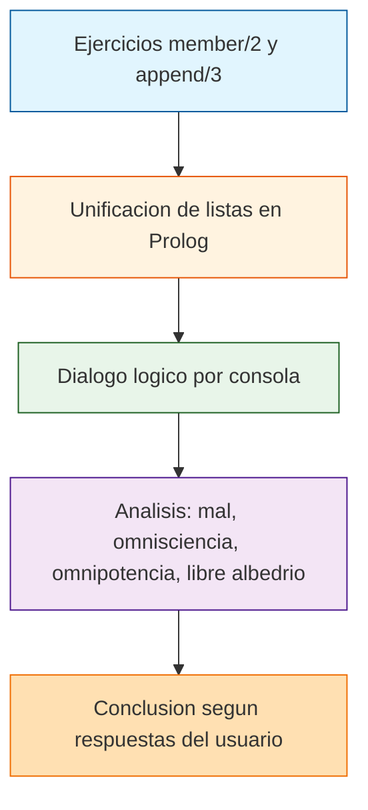

# Paradoja de Dios

<p align="center">
  <a href="https://github.com/Matthew-Garay/ParadojadeDios/actions/workflows/ci.yml"></a>
  <a href="https://github.com/Matthew-Garay/ParadojadeDios/security/dependabot"></a>
</p>

Practica de Inteligencia Artificial en Prolog con ejercicios de `member/2` y `append/3` y un dialogo logico sobre el problema del mal.

## Stack tecnologico

- **Lenguaje:** SWI-Prolog
- **Paradigma:** Programacion logica, manipulacion de listas, razonamiento logico
- **Entorno:** SWI-Prolog 8.x

## Arquitectura



## Caracteristicas

- 20 ejercicios de manipulacion de listas con `member/2` y `append/3`
- Listas anidadas y tipos mezclados
- Dialogo por consola sobre el problema del mal
- Razonamiento logico con conclusiones condicionales

## Como ejecutar

### Requisitos previos

- SWI-Prolog 8.x instalado

### Ejecucion

1. Clona el repositorio:
   ```bash
   git clone https://github.com/Matthew-Garay/ParadojadeDios.git
   cd ParadojadeDios
   ```
2. Ejecuta el archivo principal con SWI-Prolog:
   ```bash
   swipl -s listasmemberyappend.pl -g "main" -t "halt"
   ```
3. El programa ejecuta los ejercicios de listas y el dialogo logico en consola.

## Estructura del proyecto

```
ParadojadeDios/
├── listasmemberyappend.pl   # Codigo fuente en Prolog
├── Ejercicio IA.jpg         # Imagen de referencia
├── .gitignore               # Archivos excluidos del control de versiones
├── LICENSE                  # Licencia MIT
├── README.md                # Este archivo
└── docs/                    # Documentacion extendida
    ├── setup-guide.md       # Guia de instalacion
    └── architecture.md      # Diagrama de arquitectura
```

## Contacto

<p align="center">
  <a href="mailto:1911.garay.perez@gmail.com"></a>
  <a href="https://www.linkedin.com/in/matthewgarayperez/"></a>
</p>
